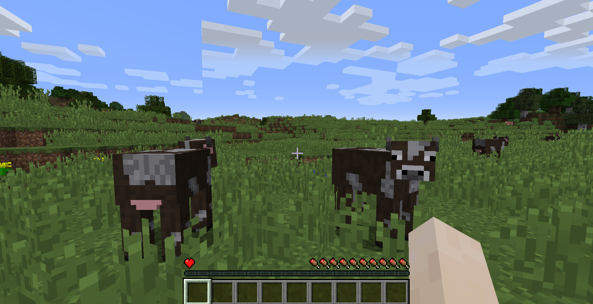

# What is it?

A simple Minecraft mod that sets player's lives to just one, making survival a lot more hardcore

# Quick Start

1. Download and install *Minecraft Forge 1.12.2*
2. Download the *.jar* file from the GitHub Releases
3. Move the downloaded file into your *mods* folder alongside your other mods
